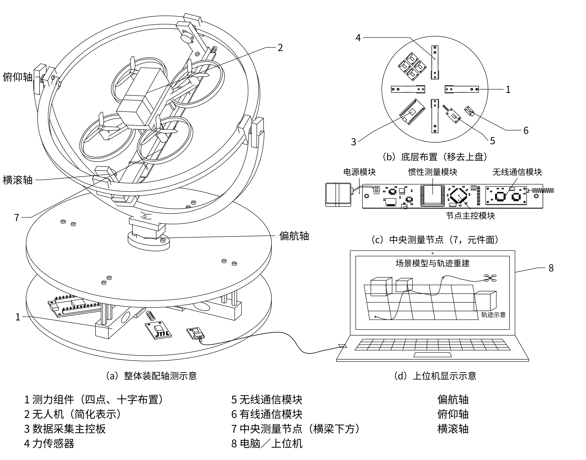
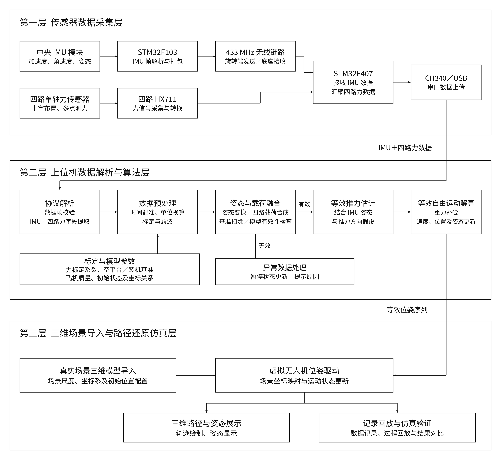

# 无人机约束飞行与轨迹重建实验平台

这是一套面向小型无人机的半实物实验平台。三轴机械结构约束无人机运动，旋转端和底座分别采集姿态与受力数据，为研究约束条件下的扰动补偿、等效自由飞行状态与轨迹重建提供数据。

平台由机械结构、双 STM32 采集节点、无线链路和上位机组成。我负责整体方案设计，以及机械、硬件、嵌入式和上位机各部分的主要开发工作。

## 平台结构

三轴约束结构承载无人机；旋转端布置 IMU，底座布置多点力传感器，采集运动与受力信息。

## 系统架构

STM32F103 旋转端采集 JY901S IMU 数据并无线发送；STM32F407 底座采集多路 HX711 力传感数据，汇集姿态数据后上传至上位机。上位机承担数据解析、可视化与后续融合研究。

## 我的工作

- 设计整体系统方案，划分机械、采集、通信和上位机模块，完成器件与电源方案选型。
- 设计并装配三轴约束结构，完成原理图与 PCB 设计。
- 开发 STM32F103、STM32F407 程序，设计 IMU、力传感器采集及节点间通信流程。
- 开发 Linux / ROS 2 上位机的数据解析与可视化功能，研究传感器融合、扰动补偿和轨迹重建。

## 主要技术

- 嵌入式与通信：STM32F103、STM32F407、C / C++、UART、无线通信、JY901S、HX711。
- 硬件与结构：PCB 设计、嘉立创 EDA、SOLIDWORKS、机械装配。
- 上位机与算法：Linux、ROS 2、Python、数据可视化、传感器融合。

## 当前进展

平台结构与双节点采集方案已形成；等效自由飞行状态与轨迹重建属于持续研究内容。当前作品集展示平台结构和系统架构。

## 说明

本项目涉及已申请专利及后续研究工作，公开作品集仅用于项目展示，核心源代码、PCB工程、机械设计源文件及算法实现暂不公开。
