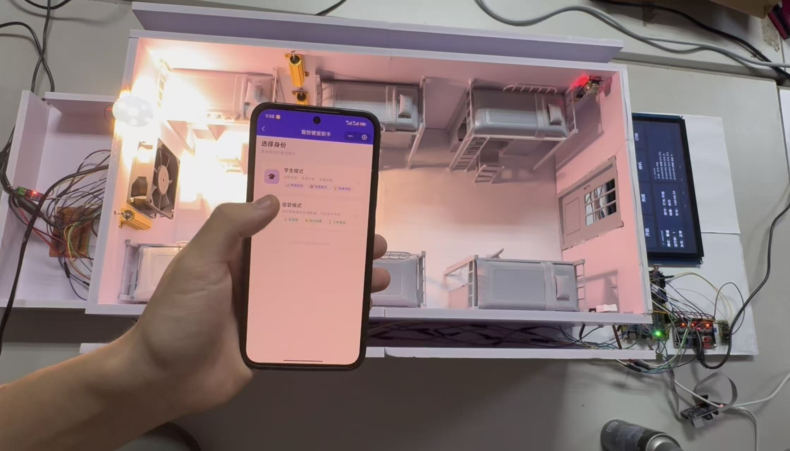

# 智能宿舍 IoT 系统

系统以 STM32U575 为本地控制核心，将传感器采集、设备执行、无线通信、串口屏和微信小程序连接起来，用于宿舍设备管理、用电状态监测和异常提醒。

## 系统实物



## 系统组成

- STM32U575 采集环境与用电数据，维护设备状态、运行模式和报警逻辑，并驱动执行设备。
- STM32WBA 提供 BLE 链路和异常用电特征检测；ESP8266 承担网络与串口数据转发。
- 串口屏 HMI 提供本地操作与状态显示；微信小程序提供手机端查看和控制。
- SerialDataLogger 记录串口数据，辅助联调；`assets/models/` 保存设备模型文件。

## 主要功能

- 采集温度、烟雾、光照、电流和功率等状态，显示设备与用电信息。
- 控制灯光、风扇、插座和门锁等执行对象，并同步本地屏幕与手机端状态。
- 提供普通、节能、安全模式，对烟雾、门锁和过载等异常进行提示。

## 我的工作

- 设计系统模块划分与设备状态管理流程，开发 STM32U575 传感器采集和执行控制逻辑。
- 接入 STM32WBA、ESP8266 无线链路，联调主控、HMI 与微信小程序之间的指令和状态同步。
- 完成系统集成与功能测试，使用串口数据记录工具排查通信问题。

## 主要技术

STM32U575、STM32WBA、BLE、ESP8266、C、微信小程序、串口 HMI、Python。

## 工程目录

```text
source/
├── stm32-u575/             主控与传感器采集
├── stm32wba-ble/           BLE 工程
├── esp8266/               网络通信程序
├── mini-program/          微信小程序
├── hmi/                   串口屏工程
└── tools/SerialDataLogger/ 串口数据记录工具
assets/models/             设备模型（3MF / STL）
docs/                      项目文档
```

## 项目资料

- [查看系统报告](docs/system-report.pdf)
- [查看串口屏通信协议](docs/hmi-communication-protocol.docx)
- [查看系统逻辑说明](docs/system-logic.docx)
