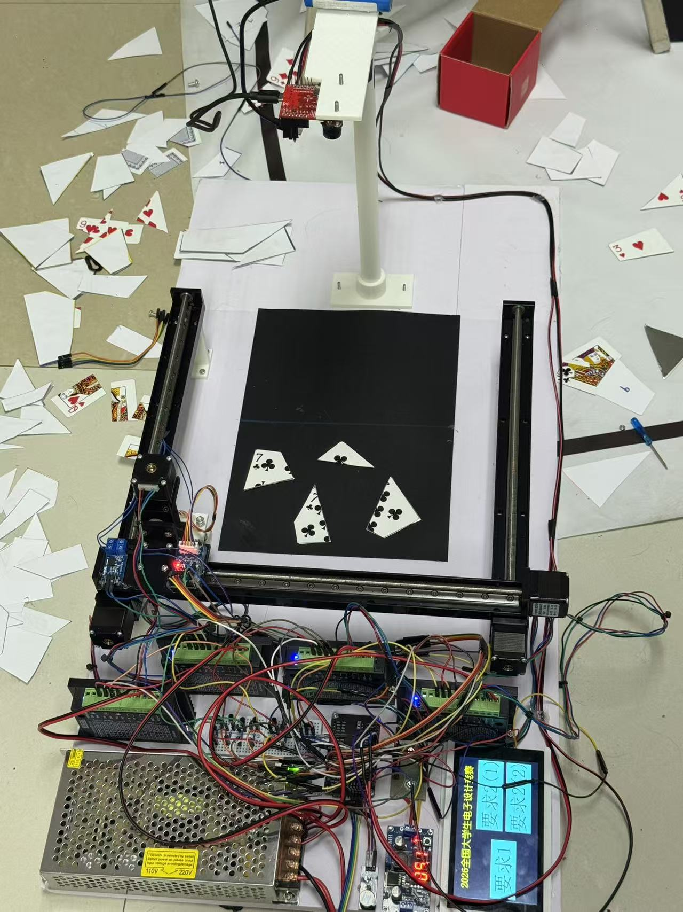

# 电赛拼图装置

全国大学生电子设计竞赛相关控制类项目。装置从图像中识别随机摆放的碎片，计算拾取与放置位置，再驱动实物机构完成搬运、旋转和拼接。

## 装置实物



## 系统组成

- OpenMV 采集图像，提取碎片轮廓与顶点；自备碎片采用模板匹配，未知碎片按几何约束求解目标位置。
- STM32F407 接收视觉端任务帧，控制三轴龙门机构、旋转末端和电磁吸取装置。
- 串口屏选择任务模式；装置按拾取、移动、旋转、释放的顺序完成动作，并给出完成提示。

## 我的工作

- 开发 OpenMV 端的碎片识别与拼接解算程序，组织不同赛题模式的运行流程。
- 开发 STM32F407 端的任务接收、运动控制和执行时序，与视觉端完成串口联调。
- 集成视觉模块、龙门机构和电磁末端，验证装置的自动拼接流程。

## 主要技术

STM32F407、C、OpenMV、MicroPython、图像处理、几何求解、步进电机运动控制。

## 工程目录

```text
407/      STM32F407 控制工程
OpenMV/   视觉识别与拼接程序
assets/   装置照片
docs/     赛题与设计报告
```

## 设计资料

- [查看拼图装置设计报告](docs/design-report.docx)
- [查看拼图装置 E 题赛题](docs/E题_拼图装置.pdf)
